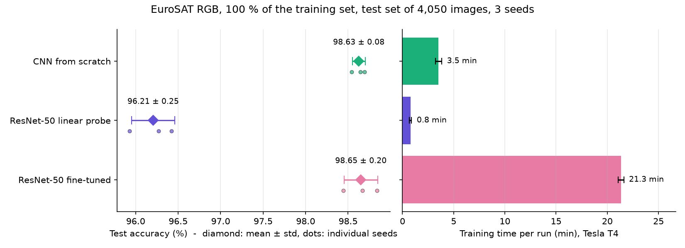
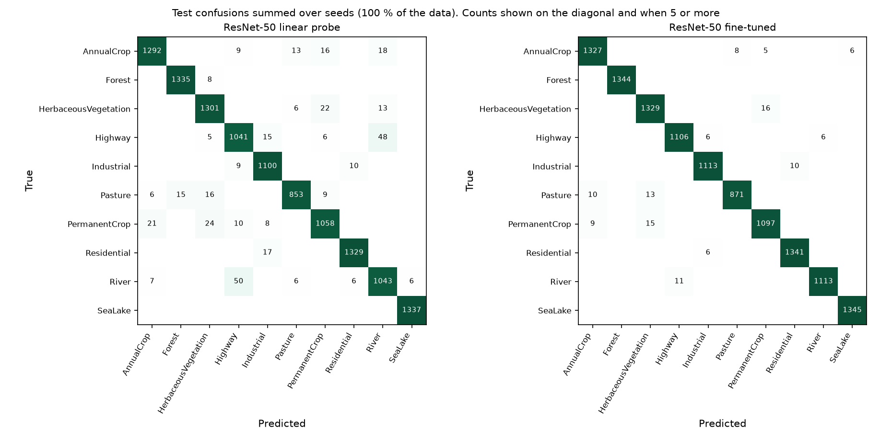
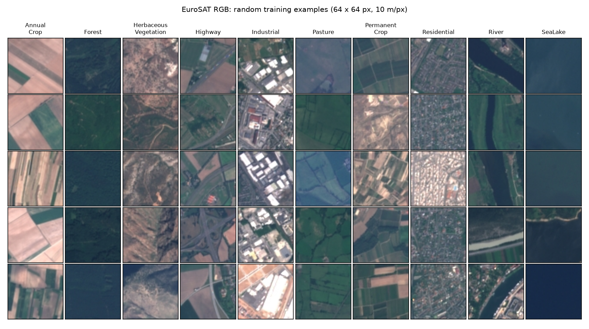
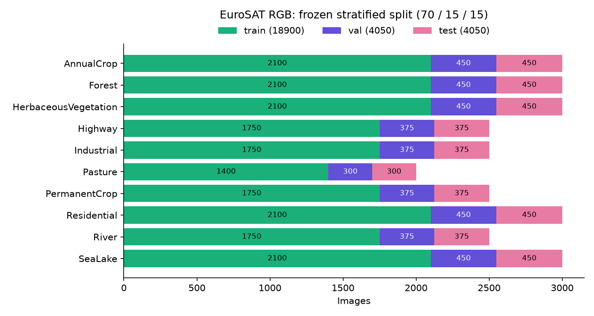

# EuroSAT onboard transfer

[](https://github.com/amine-belkacem/eurosat-onboard-transfer/actions/workflows/tests.yml)

Which transfer-learning strategy should you pick to classify Sentinel-2 image tiles when you have few labelled images and a small compute budget on board? I compare a CNN trained from scratch, a pretrained ResNet-50 and a pretrained ViT-S/16, each as a linear probe and fully fine-tuned, on three axes:

1. accuracy;
2. how many labelled images it needs (1 % to 100 % of the training set);
3. compute cost, both for training (Kaggle GPU) and for inference on a Raspberry Pi 5 standing in for an onboard computer.

> **Status: milestone 1 done** (scratch CNN and ResNet-50 at 100 % of the data). The low-data fractions, the ViT and the Raspberry Pi measurements come next, so the conclusions below only cover the full-data case.

## First results (milestone 1, 100 % of the training set)



| Config | Test accuracy (%) | Macro F1 (%) | Training time per run (min) |
|---|---|---|---|
| CNN from scratch (1.2 M params) | 98.63 ± 0.08 | 98.57 ± 0.07 | 3.5 ± 0.3 |
| ResNet-50 linear probe (20 k trainable) | 96.21 ± 0.25 | 96.04 ± 0.27 | 0.8 ± 0.1 |
| ResNet-50 fine-tuned (23.5 M params) | 98.65 ± 0.20 | 98.60 ± 0.21 | 21.3 ± 0.3 |

Mean ± sample standard deviation over 3 seeds, 4,050 test images, one Tesla T4 on Kaggle. Training time includes the periodic validation passes and, for the probe, the feature extraction.

What I take from it:

- **With all 18,900 labelled images, transfer buys nothing on accuracy.** My 1.2 M-parameter CNN and the fine-tuned ResNet-50 land within 0.02 points of each other, well inside the seed-to-seed spread. The fine-tuned ResNet-50 also matches the 98.57 % that Helber et al. report for it (on an 80/20 split, so only loosely comparable), which was my check that the pipeline is sound. It costs 6 times more training time than the CNN and 20 times more parameters to run on board.
- **Frozen ImageNet features are 2.4 points short**, and almost all of the gap is River vs. Highway (about 50 errors each way over the 3 seeds) plus the three crop and vegetation classes. Rivers and highways are both thin lines crossing the tile. Without fine-tuning, features learnt on ImageNet photos see the shape but do not weigh the colour and texture that separate water from asphalt. Fine-tuning brings River → Highway down from 50 to 11.
- The interesting part is therefore not this table but what happens with fewer labels, which is milestone 2. The probe trains in under a minute and needs no backprop through the backbone; if it holds up at 1 % while the scratch CNN collapses, the conclusion flips.



Limits of these numbers: 3 seeds give a rough spread, not a confidence interval. Hyperparameters were set once and not tuned for any model; a tuned probe (other learning rate, augmented features) would likely close part of the gap. For the scratch CNN the best validation score came at the very last step for 2 seeds out of 3. That is expected with a cosine schedule that only reaches its lowest learning rate at the end, but a longer budget might still add a little.

## Why this question

A satellite cannot downlink everything it captures. Classifying tiles on board and sending down only the useful ones saves bandwidth, as ESA showed with the onboard cloud filter of Φ-sat-1. On board, though, every millisecond and every megabyte costs something. Most EuroSAT notebooks stop at "fine-tuned model X reaches 98 %". I want to know what that accuracy costs in labelled data and in latency, and whether the ranking still holds once the model has to run on a small ARM CPU.

## Data

[EuroSAT](https://github.com/phelber/EuroSAT) (Helber et al., 2019), RGB version: 27,000 Sentinel-2 tiles of 64 × 64 px at 10 m/px, 10 land-use classes. MIT license, downloaded from the authors' [Zenodo record](https://zenodo.org/records/7711810) and checked against its MD5.



### Split

The original paper uses an 80/20 split with no validation set. I use a **stratified 70 / 15 / 15 split**, so epochs and hyperparameters are chosen on validation and the test set is only read at the end. The split is drawn once (seed 0) and committed in [`splits/eurosat_rgb.csv`](splits/eurosat_rgb.csv). A test pins its SHA-256 fingerprint, so a split that drifts would fail CI.



### Low-data subsets

Each class has its own random ranking of its training images, one ranking per seed. A subset at p % keeps the first `round(p/100 · n_class)` images of each class, rounded half up. Two consequences:

- subsets are **nested** (the 1 % subset sits inside the 5 % one, and so on), so a gain between two fractions comes from adding data, not from a luckier draw;
- each of the 3 seeds labels **different** images, so the spread I report also covers "which images happened to be labelled". At 1 % (19 images per class on average) that is a large part of the variance.

| Fraction | 1 % | 5 % | 10 % | 25 % | 100 % |
|---|---|---|---|---|---|
| Training images | 191 | 947 | 1,890 | 4,727 | 18,900 |

## Training setup

| Config | Model | What is trained | Input | Budget |
|---|---|---|---|---|
| `cnn_scratch` | 4-block VGG-style CNN, 1.18 M params | everything, from random init | 64 px | max(40 epochs, 1,500 steps) |
| `resnet50_probe` | ResNet-50, ImageNet (`resnet50.a1_in1k`), frozen | a linear layer on pooled features | 224 px | max(100 epochs, 1,000 steps) |
| `resnet50_ft` | same weights | everything; head LR 1e-3, backbone 1e-4 | 224 px | max(15 epochs, 600 steps) |

Some choices that matter:

- **Steps, not epochs.** At 1 % an epoch is 3 batches, so "15 epochs" would be 45 optimizer steps. Each run trains for the larger of an epoch budget and a step budget, is evaluated on validation at evenly spaced points, keeps the best weights and stops after a few evaluations without gain.
- **Preprocessing on the GPU.** The whole dataset fits in 332 MB as uint8, so it is loaded once. Resizing to 224 px (bicubic), flips and 90° rotations and normalization run on the GPU batch by batch. Kaggle gives two CPU cores, which would otherwise be the bottleneck.
- **Linear probe on cached features.** Each probe run extracts features for its training subset and the validation set once (that time is counted in its training time), then fits `Standardize + Linear` on them. No augmentation for the probe.
- **Test set read once**, after model selection, with a timestamp stored in the result file.
- Hyperparameters were set before the first run and are not tuned. AdamW, linear warm-up over 5 % of the steps, then cosine decay; mixed precision on GPU.

## Reproduce

```bash
python -m venv .venv            # Python 3.12
.venv/Scripts/pip install -r requirements.txt   # Linux/macOS: .venv/bin/pip
.venv/Scripts/pip install -e .
python scripts/download_eurosat.py              # ~95 MB, MD5-checked
python scripts/prepare_splits.py                # regenerates splits/eurosat_rgb.csv (identical)
python scripts/plot_dataset.py                  # figures/dataset_*.png
pytest
# quick end-to-end check on CPU (tiny budget, 200 eval images, results/_smoke)
python scripts/run_experiment.py --config configs/resnet50_probe.yaml --pcts 1 --seeds 0 --smoke
```

The real runs go through [`kaggle/milestone1.ipynb`](kaggle/milestone1.ipynb) on a Kaggle T4: it clones this repository, downloads the data, runs the configs and zips one JSON per run. `python scripts/summarize.py` then builds the tables from those files.

## Tests

`pytest` checks the split against values worked out by hand in the test comments: per-class sizes, rounding of the subset sizes (17.5 images rounds up to 18), nesting, disjointness, determinism and pinned fingerprints. The tests run on synthetic folders plus the committed CSV, so CI does not need to download the dataset.

## Roadmap

| Milestone | Content | State |
|---|---|---|
| M0 | Download, frozen split, nested subsets, tests, CI | done |
| M1 | Training loop; scratch CNN and ResNet-50 (probe and fine-tune) at 100 %, 3 seeds | done |
| M2 | ViT-S/16, all 5 fractions, 75 runs; accuracy, data-efficiency and training-time figures | next |
| M3 | ONNX export, INT8 quantization, Raspberry Pi 5 latency and memory; accuracy/latency Pareto front | |
| M4 | 13-band multispectral version: adapting RGB-pretrained weights to 13 channels | |
| M5 | Geographic vs. random split (spatial leakage) | |
| M6 | Energy per image on the Pi with a USB-C power meter | |

A note for M5: I checked that the multispectral GeoTIFFs carry their georeferencing (UTM zone, tie point and 10 m pixel scale in the GeoTIFF tags), so a geographic split is possible. [`scripts/probe_geotiff.py`](scripts/probe_geotiff.py) redoes the check: it reads a few files out of the 2.1 GB archive with HTTP range requests and prints their tags. I still have to confirm that `Label_i.jpg` and `Label_i.tif` are the same tile before reusing the coordinates for the RGB images.

## References

- P. Helber, B. Bischke, A. Dengel, D. Borth. *EuroSAT: A Novel Dataset and Deep Learning Benchmark for Land Use and Land Cover Classification.* IEEE JSTARS, 2019.
- Contains modified Copernicus Sentinel data.

## License

Code under the MIT license (see [LICENSE](LICENSE)). EuroSAT is distributed by its authors under the MIT license.
